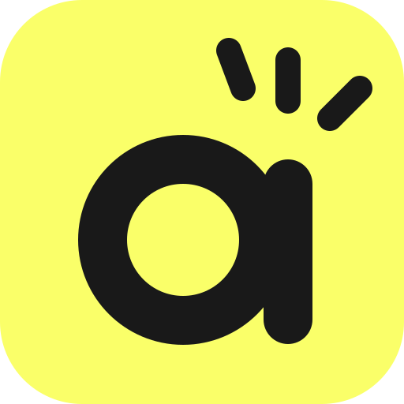

# aaiclick

aaiclick is an agent-first data framework: orchestration and a ClickHouse data warehouse in one, driven by your coding agent over MCP.

1. **Agent First (MCP)** — Your coding agent runs jobs, queries data, traces [lineage](docs/user_guide/lineage.md), and builds dashboards.
2. **Pandas-like Objects at ClickHouse Scale** — Tables behave like Python [objects](docs/user_guide/object.md); the data never leaves ClickHouse.
3. **Dynamic Task Allocation** — Tasks spawn tasks, so the pipeline shapes itself to the data at runtime.
4. **Hybrid Agentic Flow** — You control via [visibility](docs/designs/ui.md) and decision making.
5. **Multiple Languages** — [Python](docs/user_guide/task_api_python.md), [Java](docs/user_guide/task_api_java.md), or any language through the JSON [Task Interface](docs/user_guide/task_interface.md).

**Early stage — looking for early adopters to join the ride and provide feedback.**

## Installation

The base install includes embedded [chdb](https://clickhouse.com/docs/chdb) and SQLite — no external servers needed:

```bash
pip install aaiclick
python -m aaiclick setup
```

For a distributed deployment (remote ClickHouse server + PostgreSQL):

```bash
pip install "aaiclick[distributed]"
```

For lineage triage with your coding agent (Claude Code, Codex, any MCP client):

```bash
pip install "aaiclick[server]"   # or all extras: pip install "aaiclick[all]"
python -m aaiclick local start   # REST + MCP server on http://127.0.0.1:5255
```

Then point the agent at `http://127.0.0.1:5255/mcp` — see the [Lineage guide](docs/user_guide/lineage.md).

## Orchestration

Define tasks and jobs with decorators — all data operations execute as ClickHouse queries:

```python
from aaiclick import create_object_from_value
from aaiclick.orchestration import job, task

@task
async def load_sales():
    return await create_object_from_value({
        "region": ["US", "EU", "US", "EU", "US"],
        "amount": [500, 300, 150, 200, 80],
    })

@task
async def analyze(sales) -> dict:
    # GROUP BY + SUM runs as a single ClickHouse query; return a plain dict
    by_region = await sales.group_by("region").sum("amount")
    return await by_region.data()  # → {'region': ['US', 'EU'], 'amount': [730, 500]}

@task
async def report(summary: dict):
    # receives the plain Python dict returned by analyze()
    print(f"Regions: {summary['region']}")  # → Regions: ['US', 'EU']
    print(f"Amounts: {summary['amount']}")  # → Amounts: [730, 500]
    print(f"Total:   {sum(summary['amount'])}")  # → Total: 1230

@job("sales_pipeline")
def sales_pipeline():
    sales = load_sales()                # a Task, not data — nothing runs yet
    summary = analyze(sales=sales)      # gets the sales task's return value at runtime
    return report(summary=summary)      # the dict flows to report()

if __name__ == "__main__":
    from aaiclick.orchestration import job_test
    job_test(sales_pipeline)  # runs all tasks locally for debugging
```

```bash
python sales_pipeline.py
```

## Documentation

[aaiclick.readthedocs.io](https://aaiclick.readthedocs.io/en/stable/)

## Side Note: Data Operations Without Orchestration

The Object API also runs on its own, without tasks or jobs — handy for notebooks
and quick exploration. Wrap the code in `object_context()`:

```python
import asyncio
from aaiclick import create_object_from_value
from aaiclick.data.object_context import object_context

@object_context()
async def main():
    prices = await create_object_from_value([10.0, 20.0, 30.0])
    print(await (prices * 1.1).data())  # → [11.0, 22.0, 33.0]

asyncio.run(main())
```

See [ObjectContext](docs/user_guide/object_context.md).

## License

MIT License - see [LICENSE](LICENSE) for details.
