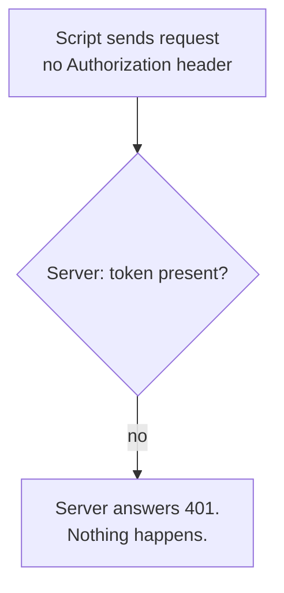

Security Model
---

Who may do what, and where secrets live.

# Scope

<!-- req: auth-scope -->
- **Users**: username + password in the orchestration SQL database, one role
  each.
- **Roles**: `viewer`, `member` or `admin`, held on `users.role`. No
  per-resource ACLs or custom roles. Every gate compares **scopes**, never
  roles — `ROLE_SCOPES` is the bridge.
- **Sessions**: password login → short-lived access JWT + rotating refresh
  token. One credential header everywhere: `Authorization: Bearer <access-jwt>`.
- **API tokens**: user-minted, named, optionally expiring bearer tokens on an
  ordered `read` < `write` < `admin` ladder, for unattended CLI / SDK / MCP
  clients — see [API Tokens](../designs/auth.md#api-tokens).
- **Mode-derived enforcement**: a hardcoded convention, not a flag —
  **disabled in local mode** (single-process chdb + SQLite; open, zero-config)
  and **enforced in distributed mode**.
- **Optional hardening**, each configuration-driven: TOTP multi-factor auth, a
  password-reset flow, a per-request audit log.

# Data Model

**Implementation**: `aaiclick/auth/models.py`

<!-- req: auth-data-model -->
IDs are snowflake `BigInteger` PKs. `role` (the one `Role` literal) and `scope`
are plain `String` columns typed with `Literal`s and validated in code (no DB
CHECK — see CLAUDE.md, "Prefer Literal"), so widening a set is a one-line code
change, not a constraint migration. `audit_log` lives in `aaiclick/audit/` — see
[Audit Log](../designs/auth.md#audit-log).

## `users`

| Column           | Type                        | Notes                                                       |
|------------------|-----------------------------|-------------------------------------------------------------|
| `id`             | `BigInteger` PK (snowflake) |                                                             |
| `username`       | `String`, unique, indexed   | Login identifier                                            |
| `password_hash`  | `String \| None`            | bcrypt; `None` → password login impossible until a reset    |
| `role`           | `String`, default `viewer`  | `Role` literal; `admin` runs the installation               |
| `disabled`       | `Boolean`, default `false`  | Disabled → cannot log in                                    |
| `email`          | `String \| None`            | Contact address                                             |
| `totp_secret`    | `String \| None`            | Base32 TOTP seed; set by MFA setup, live once `mfa_enabled` |
| `mfa_enabled`    | `Boolean`, default `false`  | Login demands a TOTP code                                   |
| `totp_last_step` | `BigInteger \| None`        | Time step of the last accepted code; refuses replays        |
| `failed_logins`  | `Integer`, default `0`      | Consecutive failed passwords or codes; reset on success     |
| `locked_until`   | `datetime \| None`          | Login refused until then                                    |
| `created_at`     | `datetime` (`utc_now`)      |                                                             |

## `refresh_tokens`

| Column       | Type                                  | Notes                                |
|--------------|---------------------------------------|--------------------------------------|
| `id`         | `BigInteger` PK (snowflake)           |                                      |
| `user_id`    | `BigInteger` FK → `users.id`, indexed |                                      |
| `token_hash` | `String`, unique, indexed             | `sha256(secret)`                     |
| `expires_at` | `datetime`                            |                                      |
| `rotated_at` | `datetime \| None`                    | Set when consumed by `/auth/refresh` |
| `revoked_at` | `datetime \| None`                    | Set on logout                        |

## `api_tokens`

| Column         | Type                                  | Notes                                                            |
|----------------|---------------------------------------|------------------------------------------------------------------|
| `id`           | `BigInteger` PK (snowflake)           |                                                                  |
| `user_id`      | `BigInteger` FK → `users.id`, indexed |                                                                  |
| `name`         | `String`                              | Free-text label (`"ci-deploy"`)                                  |
| `prefix`       | `String`                              | First 12 chars of the secret, for display                        |
| `token_hash`   | `String`, unique, indexed             | `sha256(secret)`                                                 |
| `scope`        | `String`                              | `ScopeLevel` literal — see [The scope ladder](../designs/auth.md#the-scope-ladder) |
| `expires_at`   | `datetime \| None`                    | `None` → never expires                                           |
| `last_used_at` | `datetime \| None`                    | Refreshed at most once a minute                                  |
| `revoked_at`   | `datetime \| None`                    |                                                                  |
| `created_at`   | `datetime` (`utc_now`)                |                                                                  |

## `password_reset_tokens`

| Column        | Type                                  | Notes                                      |
|---------------|---------------------------------------|--------------------------------------------|
| `id`          | `BigInteger` PK (snowflake)           |                                            |
| `user_id`     | `BigInteger` FK → `users.id`, indexed |                                            |
| `token_hash`  | `String`, unique, indexed             | `sha256(secret)`                           |
| `expires_at`  | `datetime`                            | `AAICLICK_PASSWORD_RESET_TTL`, default 1 h |
| `consumed_at` | `datetime \| None`                    | Single use                                 |

# Principal Resolution & RBAC

**Implementation**: `aaiclick/server/auth.py`

<!-- req: principal-resolution -->
`require_principal` reads the credential with `HTTPBearer(auto_error=False)` —
registering the `/docs` **Authorize** box, while a missing credential still
yields the `Problem` envelope rather than FastAPI's bare `HTTPException` — and
resolves a `Principal {user_id, role, scope, kind}`:

- **Auth disabled** → the synthetic admin; all routes open.
- **API token** (bearer starting `aaic_`) → looked up by hash; must be
  unrevoked, unexpired, and owned by an enabled user. The owner's *current*
  `role` is read on every request, so revocation and demotion bind instantly
  for tokens. `kind == "token"`, `scope` is the token's.
- **Valid access JWT** (`type="access"`, valid signature + `exp`) → `sub` and
  `role` are trusted for the token's lifetime, so disable / demote takes full
  effect only within one access-TTL (see
  [Session revocation](../designs/auth.md#session-revocation)). `kind == "session"`, `scope is
  None` — a session is unscoped, so its ceiling is its role.
- **Otherwise** → `401` with `WWW-Authenticate: Bearer`.

The resolved principal is stored on `request.state` so the audit middleware can
attribute the request afterwards. `require_principal` only authenticates: the
HTTP method says nothing about scope — `POST /viewer/query` and a dashboard run
are reads, open to a `read` token.

The guard a route declares is the one scope gate: `require_write` for a
member's own mutations, `require_admin` for everything else that mutates or
administers — jobs, objects, tasks, users, workers, audit. A test in
`aaiclick/server/test_app.py` fails any non-safe route without a guard.

# Roles

**Implementation**: `aaiclick/auth/models.py`

<!-- req: role-ceiling -->
| Role     | Scope   | Holds                                                          |
|----------|---------|----------------------------------------------------------------|
| `viewer` | `read`  | Every read                                                     |
| `member` | `write` | Reads, plus their own dashboards                               |
| `admin`  | `admin` | The installation — jobs, objects, users, workers, setup, audit |

Authority is a property of the user: one `users.role` column, bridged to the
scope ladder by `ROLE_SCOPES`. Delegation is capped at what the delegator holds
— an admin mints any scope and invites any role; a member mints up to `write`
and cannot invite. A user created without an explicit role is a `viewer`.

Every role may submit to the sandbox from a signed-in session
(`require_session` in `aaiclick/server/routers/sandbox.py`); see
`docs/user_guide/sandbox.md`.

Local mode has no credential, so a synthetic admin stands in: `role="admin"`
with `user_id=None`. That is why account routes needing a real user row answer
`422` there. The first admin comes from the startup seed or the CLI — see
[CLI & Admin Bootstrap](../designs/auth.md#cli-admin-bootstrap).

# Credentials

<!-- req: secrets-never-in-sql -->
aaiclick never handles object-store secrets: no SQL it renders carries them
(a URL with userinfo or query parameters is rejected), so the operation log
and ClickHouse's query log stay clean. ClickHouse uses
its own identity — `AWS_ACCESS_KEY_ID` / `AWS_SECRET_ACCESS_KEY` in its
process environment, or an IAM role.

| Backend           | Behavior                                                                  |
|-------------------|---------------------------------------------------------------------------|
| chdb              | Reads the aaiclick process environment; no setting needed                 |
| ClickHouse server | Refuses its ambient identity for user queries unless the profile opts in  |

The server check runs on every statement that touches an S3 table (`CREATE`,
`DESCRIBE`, `SELECT`), so the opt-in is a profile setting, not SQL:
`s3_allow_server_credentials_in_user_queries=1` in the user's profile,
shipped as `docker/clickhouse/users.d/s3.xml`. aaiclick has no setting of its
own — lending the server's identity is the operator's decision, and a client
that could switch it on per connection would make the guard moot.

The compose stack and Helm chart ship the file too, mounted but with the profile
commented out: they have no bucket credentials, so there is nothing to
lend until the operator supplies them.

`s3://bucket/key` resolves to AWS; S3-compatible servers (MinIO) take
bucket-style `http(s)://host/bucket/key`.

**Implementation**: `aaiclick/data/blob_sql.py`

`connection="lake"` names a ClickHouse named collection holding the keys
instead: `s3(lake, url = '...', format = '...')`, and `S3(...)` likewise for
the pointer engine. Each bucket can use its own keys, and the opt-in above does
not apply. The collection holds only `access_key_id` / `secret_access_key` —
aaiclick sends `url` and `format`. On chdb `connection` is ignored for S3: no
server config can hold a collection, and the process env already serves. The
name is still stored in `Schema.connection`, so job code runs unchanged on both
backends.

# Why distributed mode needs no guard

<!-- req: distributed-requires-token -->
Distributed mode requires an `Authorization: Bearer` token on every request.
The frontend sets that header itself; a script on `evil.com` cannot read your
aaiclick tab's memory, and the browser does not add the header on its own.

