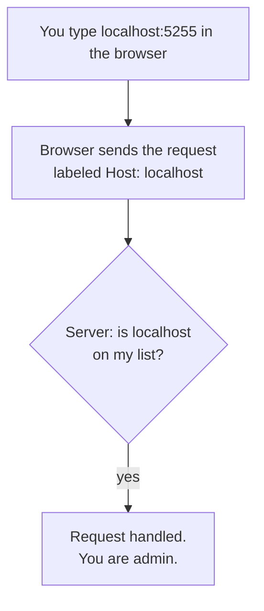
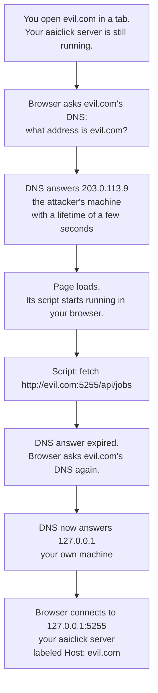
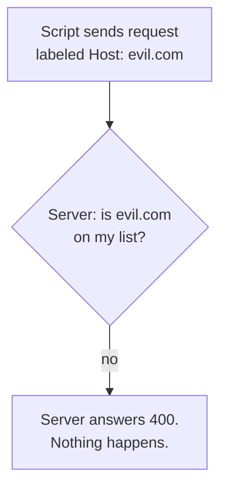
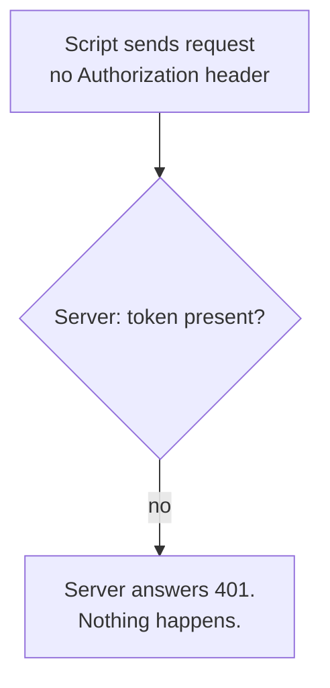

DNS Rebinding and the Host Guard
---

Local mode has no auth: anyone who can reach the server is admin. A website
open in your browser can reach it too. This page shows how, and how the `Host`
guard stops it.

# Normal use



# The attack

The attacker owns two cheap things: a website, `evil.com`, and the DNS server
that answers "what address is evil.com?". DNS is the phone book; the attacker
writes the entry and can change it any time.



The browser allows this because its rule is "a page may only talk to its own
site", and the script is talking to `evil.com`. The browser never notices that
`evil.com` now means your laptop.

# The guard

The browser always writes the site's real name into `Host`; a script cannot
fake it. The server drops any local-mode request whose `Host` is not on its
list.



The list:

```
Always on it:   localhost, 127.0.0.1, ::1
You can add:    AAICLICK_ALLOWED_HOSTS=aaiclick.lan,192.168.1.5
```

Add names only when you run `--host 0.0.0.0` and open the UI by those names.
Each name you add is trusted, so list only names whose DNS you control.

# Why distributed mode needs no guard

Distributed mode requires an `Authorization: Bearer` token on every request.
The frontend sets that header itself; a script on `evil.com` cannot read your
aaiclick tab's memory, and the browser does not add the header on its own. The
attacker can reach the server but cannot prove who they are, so the server
answers 401.



# Real-world examples

Local servers that trusted every caller and were fixed with the same `Host` check:

| CVE                                                               | Product             | What the web page could do             |
|-------------------------------------------------------------------|---------------------|----------------------------------------|
| [CVE-2024-28224](https://nvd.nist.gov/vuln/detail/CVE-2024-28224) | Ollama < 0.1.29     | Call the full model API, delete models |
| [CVE-2018-7160](https://nvd.nist.gov/vuln/detail/CVE-2018-7160)   | Node.js `--inspect` | Attach as debugger, run any code       |
| [CVE-2018-5702](https://nvd.nist.gov/vuln/detail/CVE-2018-5702)   | Transmission ≤ 2.92 | Write arbitrary files via RPC          |

The Ollama write-up by NCC Group is the clearest walk-through:
[Technical Advisory: Ollama DNS Rebinding Attack](https://research.nccgroup.com/2024/04/08/technical-advisory-ollama-dns-rebinding-attack-cve-2024-28224/).
